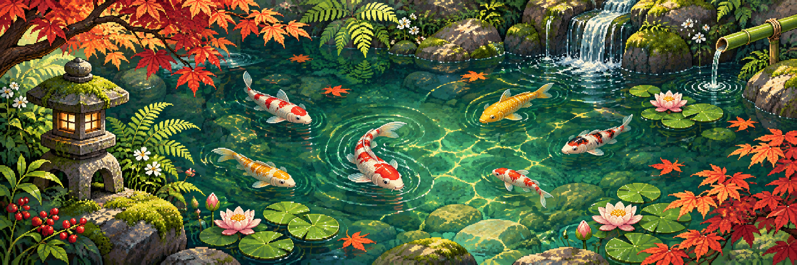
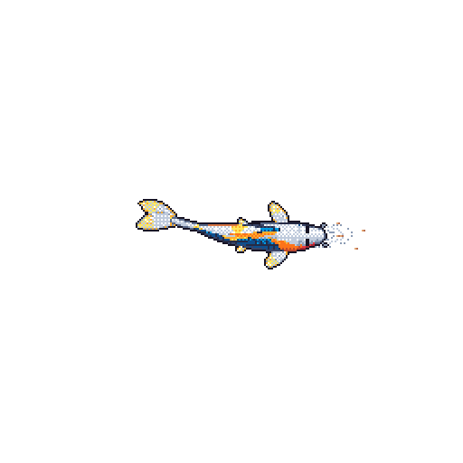

  

<h1 align="center">小さな庭 · bangahee's little garden</h1>

  <strong>Small commits. Steady growth.</strong> 
  A quiet corner for code, curiosity, and koi.

🌿 &nbsp; build a little &nbsp; · &nbsp; learn a little &nbsp; · &nbsp; let things grow &nbsp; 🍁

---

### 🌱 Around the garden

I'm bangahee. This is where I plant ideas, learn by building, and watch small projects take root.

- **On the workbench:** experiments, useful tools, and things I'm figuring out.
- **In the garden shed:** `Python` · `JavaScript` · `Shell` · `Docker`.
- **A little reminder:** progress can be quiet and still be progress.

### 💧 Meet the resident koi

<table>
<tr>
<td width="38%" align="center" valign="middle">
  
</td>
<td valign="middle">
  <h3>A little life in the pond 🐟</h3>
  
This koi grows alongside my GitHub activity. Languages give it color, contributions help it grow, and streaks leave their marks.

  
Come back another day. It might have a different story to tell.

  
Refreshed daily · Made with <a href="https://github.com/yalongwastaken/git-koi">git-koi</a>

</td>
</tr>
</table>

  <a href="https://github.com/bangahee?tab=repositories">🌾 Explore the garden</a>
  &nbsp; · &nbsp;
  <a href="https://github.com/bangahee/bangahee/actions/workflows/koi.yml">💧 Visit the pond's caretaker</a>

---

Thanks for stopping by. Take a breath, then make something. 🌿

