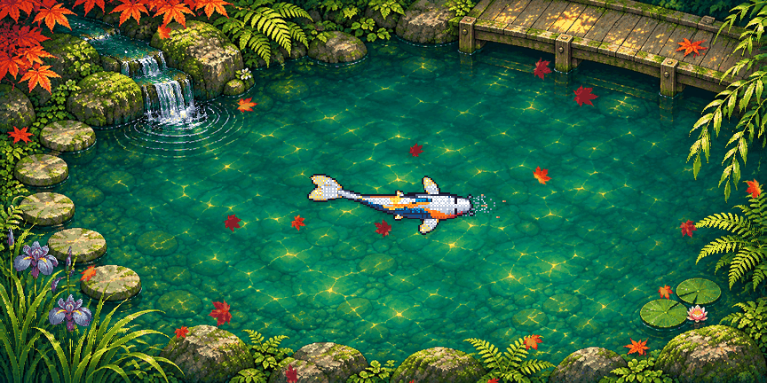
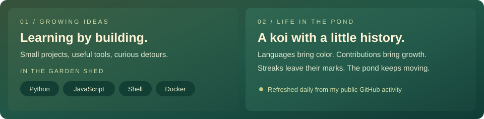

  
   
  <picture>
    <source media="(prefers-reduced-motion: reduce)" srcset="pond-banner.png" />
    
  </picture>
   
  
   
  <a href="https://github.com/bangahee/bangahee/actions/workflows/koi.yml">
    <picture>
      <source media="(prefers-reduced-motion: reduce)" srcset="koi/private-pond-still.png" />
      
    </picture>
  </a>
   
  
   
  
  
  
  
  
   
  

