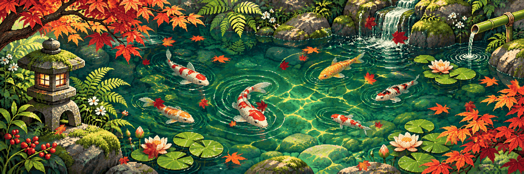
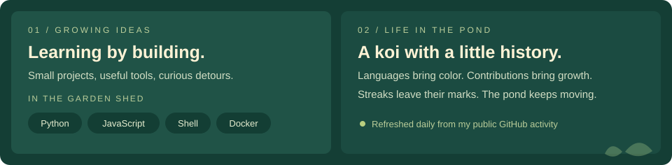
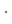

  
   
  <picture>
    <source media="(prefers-reduced-motion: reduce)" srcset="pond-banner.png" />
    
  </picture>
   
  
   
  
   
  
   
  
  
  
  
  
   Plant an idea. Give it time. Watch it grow. 🌿

